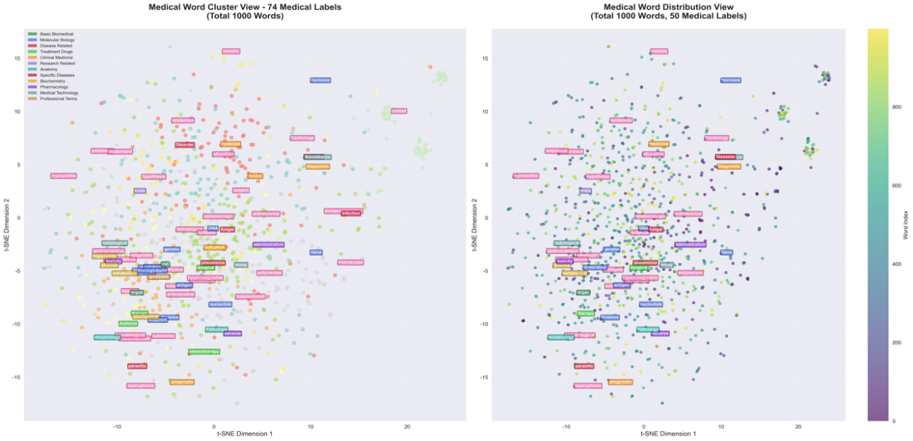
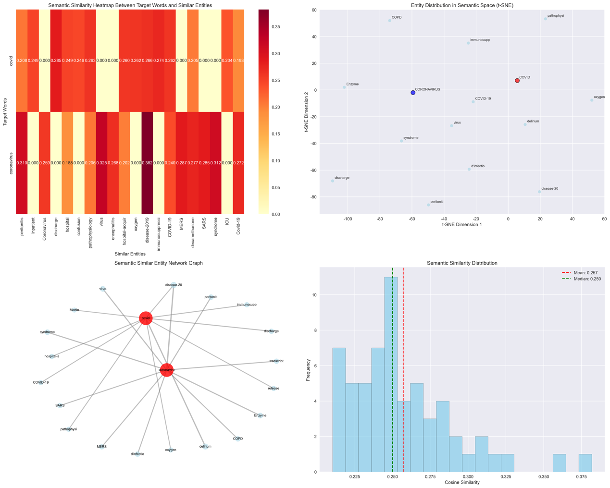
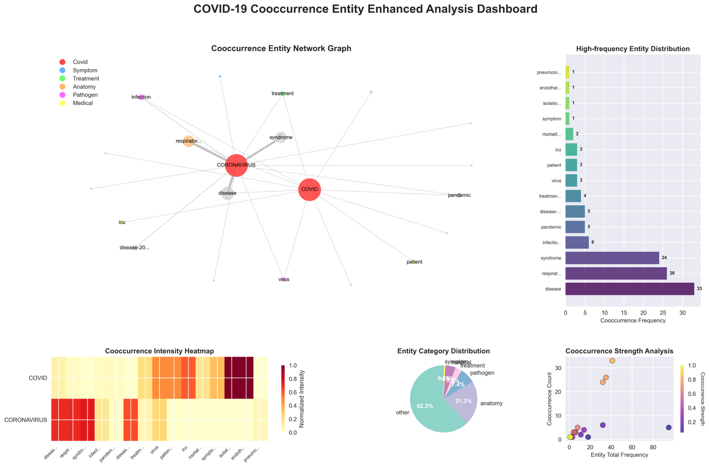

# Biomedical Word Representations on CORD-19

How can a machine learn what words like "coronavirus", "pneumonia" or "azithromycin" mean?
On **CORD-19**, a corpus of more than 400,000 scientific articles on COVID-19, we build the
whole NLP pipeline: extracting the text, splitting it into tokens, learning word vectors, and
checking what those vectors have understood about biomedical language.

> Team project, **DSI Summer School 2025, Imperial College London**.

<p>
  
  
  
  
  
  
</p>



<p align="center"><sub>1,000 word vectors projected on a plane with t-SNE: medical terms, coloured by category, next to the general vocabulary.</sub></p>

---

## At a glance

| | |
| --- | --- |
| **Question** | How should biomedical text be tokenized, and which methods learn useful word representations from it? |
| **Data** | [CORD-19](https://www.semanticscholar.org/cord19) (Allen Institute for AI): ~425,000 JSON files of scientific articles on COVID-19 and related coronaviruses. |
| **Approach** | Parsing of the full corpus; 4 tokenizers compared (`split()`, NLTK, SciSpaCy, subword/BPE, including a BPE trained on the corpus); 3 kinds of word representations (N-gram co-occurrence + SVD, skip-gram with negative sampling in PyTorch, contextual BERT embeddings); exploration with t-SNE, k-means, co-occurrence networks and cosine similarity. |
| **Main finding** | Domain-specific tools matter: SciSpaCy keeps medical terms whole where general tokenizers break them apart. Trained on small samples, the word vectors already group related terms ("coronavirus" is closest to *disease-2019*, *virus*, *syndrome*, *MERS*, *SARS*), but the similarities stay weak. |
| **Skills** | NLP pipelines on a large corpus, tokenization (NLTK, SciSpaCy, BPE with Hugging Face `tokenizers`), word embeddings (SVD, skip-gram implemented in PyTorch, BERT), dimensionality reduction and clustering, data visualisation, critical evaluation of results. |

---

## The pipeline

**1. Parsing.** We walk through the ~425,000 JSON files and join title, abstract and body
text into one document per line. The text is written as it is read, so the whole corpus is
processed in 10–15 minutes on a laptop with little memory.

**2. Tokenization: four approaches compared on the same corpus**

| Tokenizer | Strength | Weakness |
| --- | --- | --- |
| Python `split()` | Fastest, a baseline | Punctuation stays attached; "heart attack" becomes two unrelated tokens |
| NLTK | Handles punctuation and contractions | Not trained on biomedical text |
| SciSpaCy | Trained on biomedical text, keeps terms like "COVID-19" whole | Slower |
| Subword (SciBERT vocabulary, and our own BPE) | No word is ever unknown: "tracheostomy" → `trache` + `##ostomy` | Pieces are hard to read |

We also trained our own **BPE tokenizer on CORD-19** (30,000 subwords), because general
vocabularies miss many medical terms.

**3. Word representations: three families**

| Method | Idea | Setting |
| --- | --- | --- |
| N-gram co-occurrence + SVD | Words that appear together get similar vectors | 20,000 words, 3-grams, 256 dimensions (15.7% of the variance kept), 1,000 documents |
| Skip-gram with negative sampling | A small network learns to predict the words around each word | Implemented in PyTorch, 8,000 words, 256 dimensions, 15 epochs on a laptop GPU, sample of 100 sentences |
| BERT (masked language model) | The vector of a word depends on its sentence | `bert-base-uncased`: "stick" gets different vectors in "a hockey stick" and "the label won't stick" |

**4. Exploration.** t-SNE projections with k-means clusters, co-occurrence networks around
"covid" and "coronavirus", and cosine similarity between word vectors.

---

## What we found

**The vectors pick up structure.** On 1,000 random words, t-SNE and k-means isolate numbers,
years and even German words in their own clusters. With medical terms sorted by category,
related clinical terms (morphology, pathology) tend to sit close together, apart from the
general vocabulary.

**"Coronavirus" lands among sensible neighbours.** Its closest vectors include
*disease-2019*, *virus*, *syndrome*, *MERS* and *SARS*. In the corpus, the entities that
appear most often within 5 words of "covid" or "coronavirus" are *disease*, *respiratory* and
*syndrome*.



**But the signal is still weak.** The cosine similarities stay low (mean 0.26), some
neighbours are noise, and most random-word clusters have no clear meaning. This is what we
expected from vectors trained on samples of the corpus: the pipeline works end to end, and
scaling up the training data is the obvious next step.



**Limits and next steps.** Train the embeddings on the full corpus, evaluate them on a
biomedical similarity benchmark instead of by eye, and compare with contextual biomedical
models such as BioBERT.

---

## Repository layout

```
├── biomedical_word_embeddings.ipynb   the full pipeline, parts 1 to 4
├── docs/images/                       the figures of this README
├── requirements.txt
├── data/                              (not tracked: CORD-19 goes here)
└── output/                            (not tracked: corpus, tokens, vectors, figures)
```

---

## Run it

```bash
python -m venv .venv && source .venv/bin/activate
pip install -r requirements.txt
pip install https://s3-us-west-2.amazonaws.com/ai2-s2-scispacy/releases/v0.5.4/en_core_sci_sm-0.5.4.tar.gz
jupyter notebook biomedical_word_embeddings.ipynb
```

**Data.** Download the 2021-07-26 release of CORD-19 and extract it into `data/`:

```bash
mkdir -p data && cd data
wget https://ai2-semanticscholar-cord-19.s3-us-west-2.amazonaws.com/2021-07-26/document_parses.tar.gz
tar -xf document_parses.tar.gz
```

The archive is large (plan for about 100 GB of free disk space once extracted). Parsing and
tokenizing the full corpus takes hours; the embeddings of Part 3 are trained on samples, as
described above.

---

## Team

Team project carried out at the DSI Summer School 2025, Imperial College London.

The CORD-19 dataset is published by the Allen Institute for AI and its partners; see the
[CORD-19 terms of use](https://www.semanticscholar.org/cord19/download).
